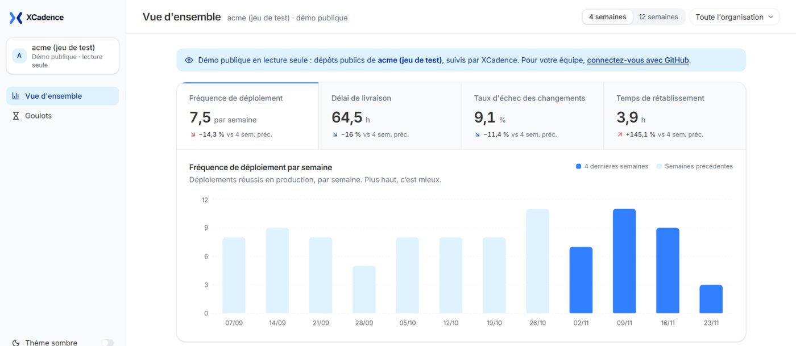
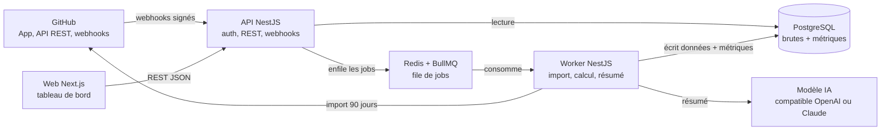

<h1>
  <picture>
    <source media="(prefers-color-scheme: dark)" srcset="docs/brand/svg/xcadence-logo-horizontal-dark.svg">
    
  </picture>
</h1>

**Radar de santé d'équipe tech.** XCadence calcule les métriques DORA et les goulots d'une équipe directement depuis GitHub, et les résume chaque semaine pour le CTO, en 5 minutes de lecture.

<picture>
  <source media="(prefers-color-scheme: dark)" srcset="docs/images/tableau-de-bord-sombre.jpg">
  
</picture>

_Capture sur le jeu de test (`pnpm db:seed`) : organisation et données fictives. Version claire ou sombre selon votre thème GitHub._

> **Version 0.1.0, bêta.** Les fonctionnalités ci-dessous sont en place et testées ; la version hébergée n'est pas encore en ligne : pour l'essayer, lancez-la en local (démarrage rapide) ou hébergez-la vous-même.

## Ce que fait XCadence

- **Connexion GitHub en 2 minutes** : une GitHub App en lecture seule, installée sur les dépôts choisis ; 90 jours d'historique importés, puis mis à jour par webhooks.
- **Les 4 métriques DORA**, par dépôt et par semaine, avec leur tendance : fréquence de déploiement, délai de livraison, taux d'échec des changements, temps de rétablissement.
- **Les goulots** : PR qui attendent une revue, PR anciennes, CI lente ou instable.
- **Un résumé hebdomadaire** de 5 lignes, écrit par une IA et vérifié chiffre par chiffre, envoyé par email chaque lundi.
- **Une démo publique** en lecture seule, sur des dépôts publics, sans compte ni installation.
- **Une interface claire ou sombre**, responsive du téléphone au grand écran.

**Ce que XCadence ne fait pas :** classer ou noter des développeurs. L'outil mesure l'équipe et le processus, jamais la performance individuelle. Il ne stocke aucun code source, seulement des métadonnées (dates, tailles, statuts).

## Démarrage rapide

Vous n'installez que **Docker** et **VS Code** avec l'extension **Dev Containers**. Node, pnpm, PostgreSQL, Redis et Mailpit viennent du dépôt.

1. Clonez le dépôt (sous Windows : dans WSL, pas dans `C:\`) et ouvrez-le dans VS Code :
   ```bash
   git clone https://github.com/kuami-labs/xcadence.git
   ```
2. **F1** → **Dev Containers: Reopen in Container**. Le premier build prend quelques minutes ; le conteneur installe les dépendances et crée `.env` depuis `.env.example`.
3. Dans le terminal du conteneur :
   ```bash
   pnpm db:migrate   # crée les tables
   pnpm db:seed      # charge le jeu de test : une organisation fictive, 90 jours d'activité
   pnpm dev          # lance l'API (4000), le worker et le web (3000)
   ```
4. Ouvrez **http://localhost:3000** : la page d'accueil ; puis **/demo** pour le tableau de bord et les goulots du jeu de test, sans compte ni GitHub App.

Pour suivre vos propres dépôts, créez votre GitHub App de développement et renseignez ses variables dans `.env` : voir [docs/06-ENVIRONNEMENT.md](docs/06-ENVIRONNEMENT.md#la-github-app-de-développement).

| Commande                         | Effet                                                                                             |
| -------------------------------- | ------------------------------------------------------------------------------------------------- |
| `pnpm dev`                       | API, worker et web avec rechargement à chaud                                                      |
| `pnpm lint`, `pnpm format:check` | ESLint, Prettier                                                                                  |
| `pnpm test`                      | tests unitaires ; d'intégration aussi si `DATABASE_URL` et `REDIS_URL` sont exportés, comme en CI |
| `pnpm build`                     | compile tout, comme la CI                                                                         |
| `pnpm db:seed`                   | charge (ou remplace) le jeu de test                                                               |
| `pnpm db:reset`                  | vide la base, rejoue les migrations et le seed                                                    |

## Architecture

Une API qui répond vite, un worker qui fait le travail lent, une file de jobs entre les deux.



GitHub pousse les événements à l'API, qui vérifie leur signature, les enregistre et les met en file. Le worker importe les données, recalcule les métriques après chaque événement et chaque nuit, écrit dans PostgreSQL, où l'API les lit pour le web.

| Dossier           | Rôle                                                          |
| ----------------- | ------------------------------------------------------------- |
| `apps/api`        | API NestJS : connexion GitHub, REST, réception des webhooks   |
| `apps/worker`     | Worker NestJS : imports, calcul des métriques, résumé, emails |
| `apps/web`        | Front Next.js : tableau de bord, goulots, paramètres, démo    |
| `packages/db`     | Schéma Prisma et migrations                                   |
| `packages/shared` | Types et constantes partagés                                  |

Stack : TypeScript, pnpm et Turborepo, NestJS, Next.js, Prisma et PostgreSQL 17, BullMQ et Redis, Vitest.

## Documentation

| Sujet                                          | Document                                             |
| ---------------------------------------------- | ---------------------------------------------------- |
| Produit, fonctionnalités, calcul des métriques | [docs/01-PRD.md](docs/01-PRD.md)                     |
| Stack et structure du monorepo                 | [docs/02-STACK.md](docs/02-STACK.md)                 |
| Backend : modules, endpoints, jobs             | [docs/03-BACKEND.md](docs/03-BACKEND.md)             |
| Frontend : pages, composants                   | [docs/04-FRONTEND.md](docs/04-FRONTEND.md)           |
| Système de design : jetons, composants, règles | [DESIGN.md](DESIGN.md)                               |
| Logo : fichiers et règles d'usage              | [docs/brand/](docs/brand/README.md)                  |
| Base de données                                | [docs/05-DATABASE.md](docs/05-DATABASE.md)           |
| Environnement, `.env`, GitHub App de dev       | [docs/06-ENVIRONNEMENT.md](docs/06-ENVIRONNEMENT.md) |
| Branches, qualité, CI, revue                   | [docs/07-COLLABORATION.md](docs/07-COLLABORATION.md) |
| Sécurité, injection de prompts                 | [docs/08-SECURITE.md](docs/08-SECURITE.md)           |
| Décisions d'architecture (ADR)                 | [docs/adr/](docs/adr/)                               |

## Contribuer

Les contributions sont bienvenues : lisez [CONTRIBUTING.md](CONTRIBUTING.md) et le [code de conduite](CODE_OF_CONDUCT.md). Une faille de sécurité se signale en privé : voir [SECURITY.md](SECURITY.md).

## Licence

[AGPL-3.0](LICENSE).
