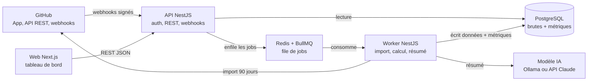

# Architecture backend – XCadence

Le backend se coupe en deux processus : une **API** qui répond vite et un **worker** qui fait le travail lent. Les deux partagent le même code NestJS et la même base.

GitHub pousse les événements à l'API, qui les enregistre et les met en file ; le worker importe, calcule les métriques chaque nuit et après chaque événement, puis écrit dans PostgreSQL, où l'API les lit.

## Modules NestJS

| Module                | Processus    | Responsabilité                                                                     |
| --------------------- | ------------ | ---------------------------------------------------------------------------------- |
| `AuthModule`          | API          | Connexion GitHub OAuth, sessions, guard par organisation                           |
| `GithubModule`        | API + worker | Client Octokit authentifié par installation, gestion des quotas                    |
| `WebhooksModule`      | API          | Vérifie la signature, enregistre l'événement, enfile un job, répond 202            |
| `SyncModule`          | Worker       | Import initial sur 90 jours, traitement des événements, resynchronisation nocturne |
| `MetricsModule`       | Worker       | Calcule les 7 métriques par semaine et par dépôt, écrit `weekly_metrics`           |
| `InsightsModule`      | Worker       | Génère le résumé hebdomadaire via `SummaryProvider`, détecte les alertes           |
| `NotificationsModule` | Worker       | Envoie le résumé et les alertes par email                                          |
| `DashboardModule`     | API          | Endpoints de lecture pour le front                                                 |

## Endpoints principaux

| Méthode et route                                     | Rôle                                                                |
| ---------------------------------------------------- | ------------------------------------------------------------------- |
| `GET /auth/github`, `GET /auth/github/callback`      | Connexion                                                           |
| `GET /auth/me`, `POST /auth/logout`                  | Utilisateur connecté et ses organisations ; déconnexion             |
| `POST /webhooks/github`                              | Réception des événements GitHub                                     |
| `GET /orgs/:orgId/repositories`                      | Dépôts et statut de suivi                                           |
| `PATCH /orgs/:orgId/repositories/:id`                | Suivre un dépôt, règle de déploiement                               |
| `GET /orgs/:orgId/repositories/:id/pull-requests`    | PR récentes d'un dépôt (sans auteur)                                |
| `GET /orgs/:orgId/metrics?repo=&from=&to=`           | Métriques DORA et de flux par semaine                               |
| `GET /orgs/:orgId/bottlenecks`                       | PR bloquées, jobs de CI lents                                       |
| `GET /orgs/:orgId/summaries/latest`                  | Dernier résumé                                                      |
| `GET /orgs/:orgId/sync-status`                       | Avancement de l'import                                              |
| `GET`, `POST /orgs/:orgId/summary-recipients`        | Destinataires du résumé par email                                   |
| `DELETE /orgs/:orgId/summary-recipients/:id`         | Retirer un destinataire                                             |
| `GET`, `POST /summary-recipients/unsubscribe?token=` | Désinscription publique en un clic (lien et RFC 8058, ADR 0005)     |
| `GET /config`                                        | Réglages publics du front (adresse d'installation de la GitHub App) |

## Jobs BullMQ

| Job                        | Déclencheur                        | Rôle                                                                                 |
| -------------------------- | ---------------------------------- | ------------------------------------------------------------------------------------ |
| `backfill-repository`      | Ajout d'un dépôt suivi             | Importe 90 jours de PR, revues, déploiements et runs                                 |
| `process-webhook-event`    | Chaque webhook reçu                | Met à jour les données brutes concernées                                             |
| `recompute-weekly-metrics` | Chaque nuit, et après un événement | Recalcule `weekly_metrics`                                                           |
| `generate-weekly-summary`  | Lundi 7 h UTC                      | Génère le résumé IA de la semaine écoulée, vérifié, ou un repli sans IA (ADR 0004)   |
| `send-notifications`       | Après chaque résumé écrit          | Crée un `send-summary-email` par destinataire, une seule fois (`sent_at`)            |
| `send-summary-email`       | `send-notifications`               | Envoie un email par SMTP (Mailpit en dev, Resend en production : ADR 0005), 3 essais |

## Sécurité

- GitHub App en lecture seule ; aucun accès en écriture au code.
- Signature HMAC SHA-256 de chaque webhook vérifiée avant traitement.
- Secrets uniquement dans les variables d'environnement.
- Guard NestJS qui filtre chaque requête par organisation.
