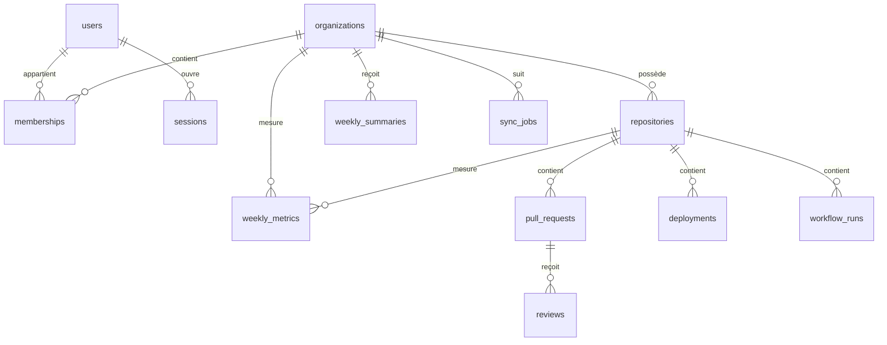

# Modèle de base de données – XCadence

La base compte 13 tables en trois groupes : les comptes, les données brutes copiées de GitHub, et les métriques calculées à partir d'elles. PostgreSQL 17, schéma géré avec Prisma (`packages/db/prisma/schema.prisma`).

| Table              | Groupe    | Colonnes principales                                                                                                                                             | Rôle                                                                |
| ------------------ | --------- | ---------------------------------------------------------------------------------------------------------------------------------------------------------------- | ------------------------------------------------------------------- |
| `users`            | Comptes   | id, github_id, login, email, avatar_url                                                                                                                          | Personne qui se connecte                                            |
| `organizations`    | Comptes   | id, github_org_id, name, installation_id                                                                                                                         | Organisation GitHub connectée                                       |
| `memberships`      | Comptes   | user_id, organization_id, role (owner, member)                                                                                                                   | Qui voit quelle organisation                                        |
| `sessions`         | Comptes   | id, token_hash (unique), user_id, expires_at                                                                                                                     | Sessions de connexion ([ADR 0003](adr/0003-sessions-postgresql.md)) |
| `repositories`     | Brutes    | id, organization_id, github_repo_id, name, default_branch, is_tracked, deploy_rule                                                                               | Dépôts suivis et règle de détection des déploiements                |
| `pull_requests`    | Brutes    | id, repository_id, github_pr_id, number, author_login, state, is_draft, created_at, first_commit_at, first_review_at, merged_at, closed_at, additions, deletions | Base des délais et goulots                                          |
| `reviews`          | Brutes    | id, pull_request_id, github_review_id, reviewer_login, state, submitted_at                                                                                       | Temps avant première revue                                          |
| `deployments`      | Brutes    | id, repository_id, github_deployment_id, sha, environment, status, created_at, finished_at                                                                       | Fréquence, échecs, rétablissement                                   |
| `workflow_runs`    | Brutes    | id, repository_id, github_run_id, workflow_name, branch, conclusion, started_at, completed_at                                                                    | Durée et stabilité de la CI                                         |
| `weekly_metrics`   | Calculées | id, organization_id, repository_id (null = toute l'organisation), week_start, metric_key, value, sample_size                                                     | Une ligne par métrique, dépôt et semaine                            |
| `weekly_summaries` | Calculées | id, organization_id, week_start, content, model, sent_at                                                                                                         | Résumés IA envoyés                                                  |
| `sync_jobs`        | Technique | id, organization_id, type (backfill, webhook, recompute), status, started_at, finished_at, error                                                                 | Suivi des imports                                                   |
| `webhook_events`   | Technique | id, delivery_id (unique), event_type, payload (jsonb), received_at, processed_at                                                                                 | Reçus bruts, traités une seule fois                                 |

## Relations

## Contraintes et index

- Unicité sur chaque identifiant GitHub (`github_pr_id`, `github_run_id`…) : un import rejoué met à jour au lieu de dupliquer.
- Identifiants internes en UUID v7 (non devinables dans les URL de l'API, triés par date) ; identifiants GitHub en `BIGINT`.
- Unicité sur `(organization_id, repository_id, week_start, metric_key)` avec `NULLS NOT DISTINCT` : une seule ligne « toute l'organisation » par semaine et métrique (clause ajoutée à la main dans la migration, Prisma ne la génère pas).
- Unicité sur `webhook_events.delivery_id` : un webhook reçu deux fois n'est traité qu'une fois.
- Index sur `(repository_id, merged_at)`, `(repository_id, created_at)` et `(repository_id, week_start, metric_key)`.
- Aucune donnée de code source n'est stockée : seulement des métadonnées (dates, statuts, tailles).
